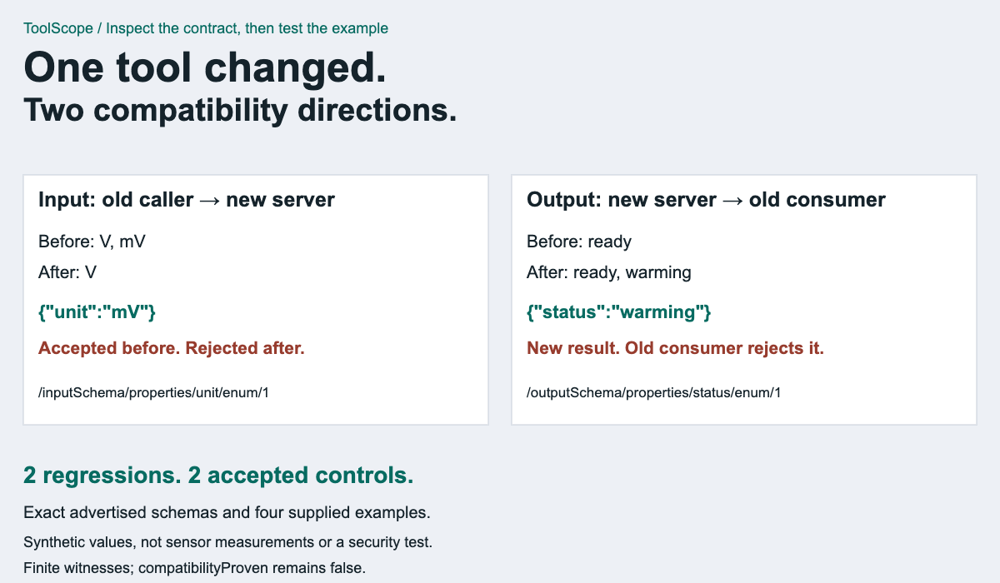
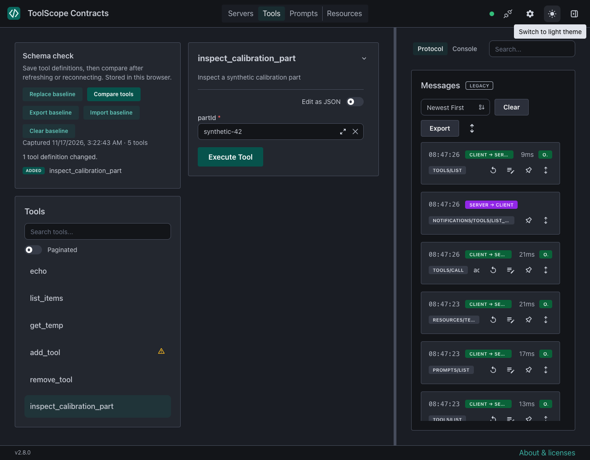

# ToolScope

**The old fixture returned 3300 mV. The revised contract rejects that call.** The synthetic `read_voltage` tool dropped `mV` from its input enum. A valid new `V` call returns **3.3 V · warming**, a status the old consumer schema rejects. Both values are fixed fixture outputs.

[Inspect the fixture in the GUI](docs/presentation/README.md#run-the-real-inspector) · [Check the saved contracts with the CLI](#check-the-saved-contracts-with-the-cli) · [Download the reader bundle](https://raw.githubusercontent.com/nazeeh111/ToolScope/8fead5a1a1eccdfbb2fe2f3438d53b9cf16e503f/docs/presentation/toolscope-contract-reader.zip)

ToolScope is a local workspace adapted from [MCP Inspector](https://github.com/modelcontextprotocol/inspector). See the [license and upstream attribution](LICENSE). The bundled example needs no model, account or hardware.

<a id="follow-one-live-contract-change"></a>

<picture>
  <source media="(max-width: 600px)" srcset="docs/presentation/contract-mobile.png">
  
</picture>

The offline checker found **two regressions and two accepted controls** among four supplied examples. Its report records `compatibilityProven: false`. [Exact report](docs/presentation/probe-report.json) · [Actual workspace on desktop](docs/presentation/workspace-desktop.png) and [phone](docs/presentation/workspace-mobile.png)

<a id="start-with-a-concrete-change"></a>

## Check the saved contracts with the CLI

Use **Node.js 24** and run these commands from a source checkout. They use the same voltage fixture and require no server connection.

```sh
git clone https://github.com/nazeeh111/ToolScope.git
cd ToolScope
INSPECTOR_SKIP_CLIENT_INSTALL=1 npm ci
node scripts/probe-tool-baselines.mjs docs/presentation/before.json docs/presentation/after.json docs/presentation/probes.json
```

The command exits **1** because it witnesses two supplied regressions.

| Supplied example | Old schema | New schema |
| --- | --- | --- |
| Input `unit: "V"` | Accepts | Accepts |
| Input `unit: "mV"` | Accepts | Rejects |
| Result `3.3 V, ready` | Accepts | Accepts |
| Result `3.3 V, warming` | Rejects | Accepts |

The input check asks whether a new server accepts an old call. The output check asks whether an old consumer accepts a possible new result. The report records hashes and byte counts without embedding the checked values or file paths. Unsupported schemas and inconclusive cases remain visible. [Report format and limits](docs/review-a-tool-change.md).

<a id="run-the-desktop-app"></a>
<a id="check-a-changing-tool-interface"></a>

## Use the inspector

Connect a local MCP server to inspect tools, resources and prompts, then save a definition baseline and review changes. Install the four clients and build the local examples:

```sh
npm --prefix clients/web ci
npm --prefix clients/cli ci
npm --prefix clients/tui ci
npm --prefix clients/launcher ci
npm run build:toolscope
npm run toolscope
```

Open the printed local URL. ToolScope creates its own writable `.toolscope/mcp.json` catalog with **Tool contracts** and **Resources and prompts**. Each local server starts when you connect; existing catalogs are preserved. The authenticated Node backend is required.

1. Connect **Tool contracts**, open **Tools**, and **Save baseline**.
2. Call the synthetic `add_tool` with a name and description, then refresh the list.
3. **Compare tools** to inspect the added definition and changed JSON-pointer locations.
4. Export the baseline; import it later for the same catalog server. Existing baselines require confirmation before replacement.

Baselines contain advertised definitions, not call arguments, results or authentication data. They persist in this browser. Definitions may still contain private descriptions; inspect exports before sharing. Refresh and load every page before comparing. Malformed or incomplete lists cannot be saved as a valid baseline.



The compact view menu switches between tools, resources, prompts and monitoring. On narrow screens the list and editor stack vertically. [Actual comparison and phone captures](docs/images/source-preview/CAPTURES.md) use the bundled synthetic server.

## Choose a surface

| Task | Command or surface |
| --- | --- |
| Inspect a server and its responses | Browser workspace |
| Read the bundled tool list as JSON | `node scripts/toolscope.mjs --cli --server "Tool contracts" --method tools/list --format json` |
| Open the terminal client | `npm run toolscope -- --tui` |
| Compare definitions, without a server | `node scripts/compare-tool-baselines.mjs baseline.json current.json` |
| Check supplied call/result examples | `node scripts/probe-tool-baselines.mjs baseline.json current.json cases.json` |

The structural comparator exits 0 for a match, 1 for differences and 2 for invalid input. The probe command exits 0 when all supplied examples are accepted, 1 when it witnesses a regression, and 2 for invalid or inconclusive input. A regression report can also contain unknown cases; read the whole result. [Full formats, numeric admission and bounded evaluation](docs/offline-comparison.md). The local `add_tool` fixture accepts a convertible object JSON Schema or the existing empty-schema shorthand; conversion failures return a tool error before registration. Inspect the advertised definition: the experimental reverse converter is not a universal JSON Schema converter.

The existing [v0.3.1 offline kit](https://github.com/nazeeh111/ToolScope/releases/tag/v0.3.1) remains a separate structural-comparison artifact. The new probe command runs from this source checkout with dependencies installed. No new release or npm package is implied.

## Local boundaries

ToolScope uses `.toolscope/` for its catalog, settings, OAuth state and logs; `TOOLSCOPE_DATA_DIR` selects another location. Secrets use the in-memory backend by default. Connections you add can execute local commands or contact remote services. Host, origin and session-token protections remain enabled. No model is needed for local inspection; connecting a third-party server retains that server's requirements.

[Complete technical guide](TECHNICAL_GUIDE.md) · [Verification](docs/source-preview-verification.md) · [Architecture](docs/architecture.md) · [Secret storage](docs/secret-storage.md) · [Contributing instructions](AGENTS.md)
