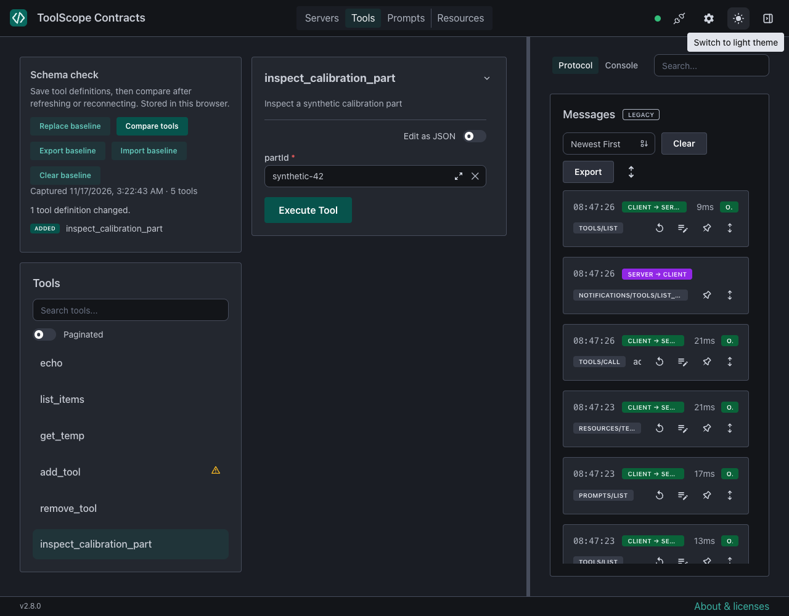
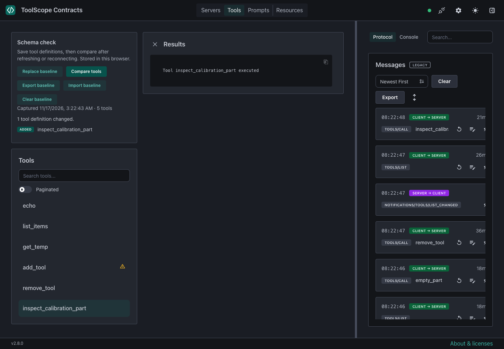
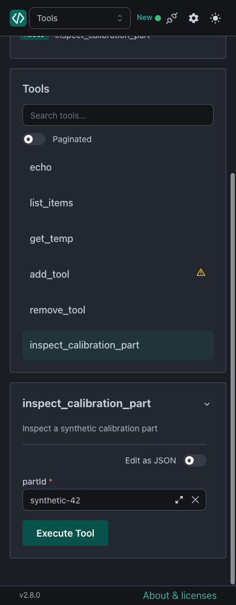

# ToolScope source-preview captures

These are actual local browser captures of this source preview, taken on 17 November 2026. They use the bundled synthetic Tool contracts server, task-owned browser state and the in-memory secret backend. No account, model, real credentials or private server was used. The displayed v2.8.0 is the inherited inspector version, not a new ToolScope release.

## Baseline and input form

1280 × 1000, dark theme. A five-tool baseline is compared with the refreshed six-tool list. The new synthetic `inspect_calibration_part` definition requires a string `partId`.

## Actual tool result

1440 × 1000, dark theme. The same typed synthetic tool has executed successfully. The comparison identifies one added definition. Message timings are incidental local observations, not a performance benchmark.

## Compact editor

390 × 1000, dark theme, scrolled to the stacked list and editor. The fixed header contains the view menu. The list, editor and monitoring views remain available without squeezing the desktop columns together.

Images are unaltered browser captures. Layout checks also covered 320 and 1280 pixels in both themes. This is bounded Chromium verification, not an all-device or assistive-technology certification. See [verification](../../source-preview-verification.md).
